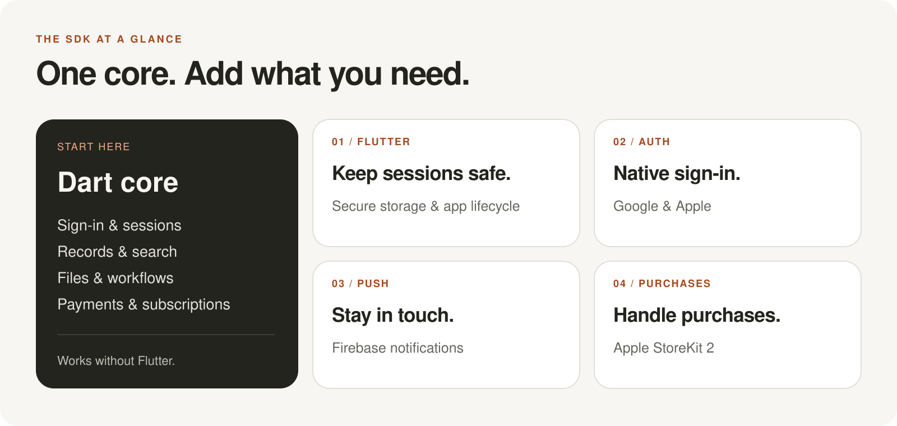

<p align="center">
  
</p>

<h1 align="center">Anythink for Dart and Flutter</h1>

<p align="center">
  Connect your app to Anythink. Add native integrations when you need them.
</p>

<p align="center">
  <a href="#try-it-locally"><strong>Get started</strong></a>
  &nbsp;·&nbsp;
  <a href="integration/native_host/README.md"><strong>Run the app</strong></a>
  &nbsp;·&nbsp;
  <a href="docs/consumer-api-coverage.md"><strong>API coverage</strong></a>
</p>

**Independent, unofficial and not yet published.** See [validation](docs/validation.md)
for what has been tested and what remains.

## Choose your packages

<p align="center">
  
</p>

| Package | Use it for |
| --- | --- |
| [anythink_dart](packages/anythink_dart/README.md) | Sign-in, records, search, files, workflows, payments and subscriptions |
| [anythink_flutter](packages/anythink_flutter/README.md) | Save sessions securely and refresh them when the app resumes |
| [anythink_flutter_auth](packages/anythink_flutter_auth/README.md) | Native Google and Apple sign-in |
| [anythink_flutter_push](packages/anythink_flutter_push/README.md) | Firebase notifications and device registration |
| [anythink_flutter_purchases](packages/anythink_flutter_purchases/README.md) | Verify and complete Apple StoreKit 2 purchases |

The core works without Flutter. Each package declares its own minimum Dart and
Flutter versions; see [compatibility](docs/compatibility.md).

## Try it locally

You need an Anythink project, its regional API origin, and an application user
with permission to access your data. Keep administrator credentials out of apps.

Until publication, point your app at this checkout. For a neighboring Flutter app:

```yaml
dependencies:
  flutter:
    sdk: flutter
  anythink_dart: ^0.1.0-dev.1
  anythink_flutter: ^0.1.0-dev.1

dependency_overrides:
  anythink_dart:
    path: ../anythink-dart/packages/anythink_dart
  anythink_flutter:
    path: ../anythink-dart/packages/anythink_flutter
```

Adjust the paths, then run `flutter pub get`. Add a matching dependency and path
override for each optional package you choose. Keep the core override too.

This example signs in and reads an existing `notes` entity:

```dart
import 'package:anythink_dart/anythink_dart.dart';

Future<List<JsonObject>> readNotes({
  required Uri apiOrigin,
  required String projectId,
  required String email,
  required String password,
}) async {
  final client = AnythinkClient(apiOrigin: apiOrigin, projectId: projectId);
  try {
    await client.auth.signInWithPassword(email: email, password: password);
    final page = await client.records('notes').list(
      query: RecordQuery(pageSize: 20),
    );
    return page.items;
  } finally {
    try {
      await client.auth.signOut();
    } finally {
      await client.close();
    }
  }
}
```

For a running app, keep one client for its session instead of creating one per
request. The [Flutter setup](packages/anythink_flutter/README.md) adds secure
persistence and explicit restoration. A [runnable Dart example](packages/anythink_dart/example/anythink_dart_example.dart)
shows typed records and error handling.

## See it on a phone

<p align="center">
  
</p>

The [native test app](integration/native_host/README.md) lets you sign in, restore
a saved session, refresh your account and sign out. This is its real sign-in
screen; Google, Apple, push and purchases have separate test flows.

## Next steps

- [API coverage](docs/consumer-api-coverage.md): available operations and remaining contracts.
- [Billing](docs/billing.md): plans, access checks, checkout and Apple verification.
- [Architecture](docs/architecture.md): sessions, refresh, retries and package boundaries.
- [Native test app](integration/native_host/README.md): run the SDK on a device.
- [Provider setup](integration/native_host/PROVIDER_READINESS.md): Google, Apple, Firebase and StoreKit requirements.

Before using confidential data, review the measured [search limitations](docs/search-validation.md)
and [file-access results](docs/live-validation.md#separate-executed-file-and-read-observations).
Backend permissions, including file access across users, must match your app's needs.

## Develop and contribute

```sh
flutter pub get
bash tool/check.sh
```

This runs formatting, analysis and automated tests. It does not publish anything
or run provider purchases. Use the separate [live validation guide](docs/live-validation.md)
for real-backend checks. Changes should include relevant tests and documentation;
keep credentials and local provider configuration out of source control.
