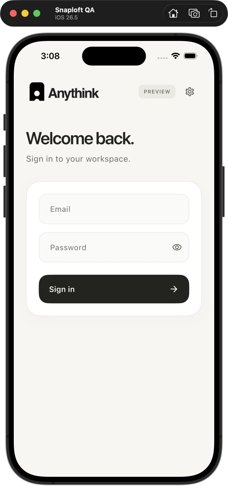

# Native SDK test app

A small app for checking that the SDK works on a phone. You can sign in, refresh
your account, use a saved session and sign out. It also links all five SDK
packages so native builds check their dependencies together.

<p align="center">
  
</p>

This is a development test app, not the planned product demo. The
[validation record](VALIDATION.md) separates real-device results from automated
tests; [provider readiness](PROVIDER_READINESS.md) lists Google, Apple, Firebase
and purchase setup.

## Build the app

Resolve dependencies with `flutter pub get` from the repository root. Then run
these commands from `integration/native_host`, replacing the public configuration:

```sh
flutter build apk --debug --no-pub \
  --dart-define=ANYTHINK_API_ORIGIN=https://your-region.anythink.cloud \
  --dart-define=ANYTHINK_PROJECT_ID=your-project-id

flutter build ios --simulator --debug --no-codesign --no-pub \
  --dart-define=ANYTHINK_API_ORIGIN=https://your-region.anythink.cloud \
  --dart-define=ANYTHINK_PROJECT_ID=your-project-id
```

Use the exact regional API origin and project ID from Anythink. With no defines,
sign-in is disabled and **Settings** shows **Not connected**. Device builds need
appropriate local signing; no signing credentials are committed.

Only public configuration goes in build defines. Enter a test user's password
on the sign-in screen; it is cleared after the attempt. Tokens stay out of the UI
and logs. Optional provider flows are off in the normal host and have separate
integration entrypoints.

## Check sessions manually

Use an ordinary user in a dedicated test project:

1. **Sign in** to load your account. **Refresh account** fetches it again.
2. Restart the app, then tap **Use saved session**.
3. Tap **Sign out**, restart and check that **Use saved session** is hidden.

**Settings** shows the API origin, project and session state. The app checks local
storage before offering **Use saved session**; restoration starts only when you
tap it. Foreground refresh checks begin after sign-in or restoration. Closing
the screen does not erase the saved session.

## Automated checks

Run `flutter test --no-pub` from this directory for host tests. The real-backend
session runner uses separate processes to check persistence, refresh and logout:

```sh
# From the repository root, with the private test configuration prepared:
python3 integration/native_host/tool/run_android_session_validation.py \
  --config .secrets/live-contract.json
```

With private Firebase configuration prepared, run
`python3 integration/native_host/tool/run_android_firebase_validation.py --mode rotation`
to check token replacement and logout on Android. This sends no notification;
the default `delivery` mode waits for a Firebase console test message.

The [live validation guide](../../docs/live-validation.md) describes private
configuration. Runners transfer credentials through app-private files, never
build defines, and refuse to overwrite a saved session. Inspect a failed gate
before retrying. Flutter owns installation and may uninstall on an install
failure; `--no-uninstall` only disables test teardown. Restart tests require
retained state and new process IDs so data loss cannot count as a pass.

See [validation](VALIDATION.md) for iOS simulator, physical iPhone, interruption
and provider test results. After a device integration run, rebuild/install
`lib/main.dart` with public configuration to restore the normal signed-out host.
